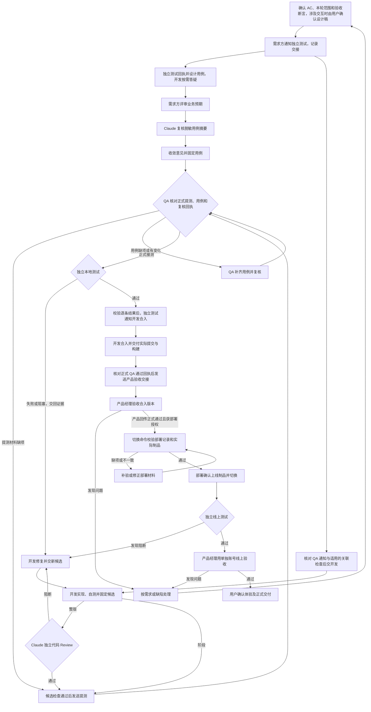

# ROOT 开发、验收与部署分工

新需求和整版交付均以已确认的验收条件为准。以导表后增加负责人筛选为例，验收要核对筛选结果、原工具及已有记录，并在刷新后重新打开核对。

需求方在 A「确认需求和验收条件」阶段，对每项新增或变更的 AC 记录「本轮范围」「本轮不做」「验收断言」。范围说明适用角色、入口、数据及生效条件，只写与本次变更有关的边界。「本轮不做」写清留待后续的行为，或继续沿用现行规则的对象。后者若与本轮有交界，列入回归，例如新邀请码改有效期时验证旧码到期时间。开工与提测沿用同一份 AC。测试按范围写用例，按边界写必要的回归，范围变化时更新受影响的用例。

**需求就绪通知。** A 阶段完成后，需求方用 `ready --send-to` 向独立测试 Agent 发送 AC 编号、需求及设计入口、范围和排除项，并在原需求记录发送日期和测试回执。测试用 `qa-design-ack --send-to` 回复认领、用例入口和待澄清项，由需求方复核业务预期。开发按需异步回答技术可行性、历史数据准备或故障构造问题。

**正式提测。** 开发提交固定 SHA、构建标识、可访问入口、自测证据和已知问题。测试核对正式提测与已复核的用例，范围或候选有变化时复核受影响的断言，再接测并记录结果。

| 角色 | 职责 | 交接产物 |
| --- | --- | --- |
| 需求方／产品经理 | 确认用户场景、范围与验收条件。涉及布局、状态或操作路径时，用户看稿确认后登记 Ready。评审用例的业务预期，独立测试结束后按需求逐项验收用户操作、反馈和业务结果。 | 已确认的设计稿和验收条件、用例评审意见、逐项产品验收回执。 |
| 开发 | 实现和修复，完成自测。交付时把确认的改动合入主干，从主干固定上线候选。 | 完整提交、构建标识、自测证据及已知问题。 |
| 独立代码评审（Claude） | 作为非同源大模型审查 Codex 的固定候选，重点检查源码、配置、权限隔离、数据保护和失败恢复。阻断项交回开发，修复后复审。 | 候选 SHA、评审模型、审查范围、问题与复审结论。 |
| 独立测试 | 依据需求设计用例，在固定候选执行端到端、接口、权限与隔离、失败恢复和部署后技术复验。 | 测试设计、执行结果、覆盖口径、缺陷及测试结论。 |
| 部署 | 核对上线提交和制品，准备环境、备份及回退。在授权范围内切换版本，记录服务器实际运行的版本和入口。 | 制品及校验值、运行版本、部署和回退回执。 |
| 用户 | 体验最终线上候选，核对评审能否使用入口和交付材料，决定是否正式开放或提交。 | 体验反馈、放行或交付确认。 |

Claude 的用例复核在开发前进行。代码 Review 在固定候选自测后、独立测试前进行，按[整版交付前代码 Review 门禁](../质量门禁设计.md#整版交付前代码-review-门禁)留存结论。

本机 Wiki 可查[交接失败如何处理](http://127.0.0.1:17437/#/_source/root-agent-handoff-ci.md)。正式命令和字段见[本地 CI 操作](#本地-ci-操作)。

## 产品验收方法

独立测试通过后通知开发合入。开发交回实际合入 SHA、构建和可访问入口，需求方收到交接后核对运行版本，再用独立账号验收。部署后的产品验收按部署回执和线上独立测试结论核对实际运行构建。合入或部署引入额外改动时，核对影响范围及相应回归证据。

按用户目标走完整旅程，再把结果映射回需求编号。每条旅程使用新的示例输入，检查入口能否找到、操作和文案是否符合已确认稿、结果能否实际使用，以及退出或刷新后能否找回。整版验收还覆盖官网试玩、网站预览导航、导表数据保留、工具版本历史与授权后台。与本次变更无关的已验旅程可引用旧证据，注明适用版本和范围。

| 本轮用户旅程 | 产品验收断言 |
| --- | --- |
| 首次进入与回访 · AC-004、AC-011、AC-016 | 从官网凭邀请码注册，直接进入居中新建页。确认指引指向输入框，聚焦或 Esc 后收起。刷新、重登时验证同一布局和两张入口卡片。 |
| 左栏切换与草稿 · AC-011～AC-013 | 从左栏进需求助手、保存草稿，再从「我的需求」找回、编辑并带回居中新建页。核对当前项高亮，「需求助手」和「从表格生成」卡片进入各自流程。在 390 px 复走关键步骤。 |
| 有旧工具时新建 · AC-001、AC-002、AC-006 | 先在已有工具里保存一条记录，再点新建。输入居中，点「开始」后显示进度。新建失败保留需求并可重试，成功后才显示本次工具。从「我的工具」重新打开旧工具，核对原记录仍可操作。 |
| 继续修改已保存工具 · AC-006、AC-007、AC-018-B2、AC-018-C | 从「我的工具」打开有记录的工具，检查同一对话中的澄清、修改前确认、失败和修复回执。调整后旧方案失效，取消或失败时旧工具可继续新增记录。应用候选后同一工具产生新版本，刷新重开能找回记录和对话。对照桌面和窄屏的导航、消息滚动和输入区。 |

每条回执记录需求编号、环境、实际 SHA／构建、账号角色、输入、实际结果及关键截图。按「通过、失败、阻塞、未执行」登记。用户看得见的业务断言由产品验收亲自走，接口、隔离、并发和故障注入引用独立测试回执。产品验收通过后进入部署交接。

独立测试报告记录需求映射、实际执行、通过情况和已测量的覆盖率，区分真实模型、模型替身、接口和目标环境的证据。部署按固定制品核对服务器实际运行版本。正式交付采用完成目标环境测试和产品验收的版本。

## 本地 CI 操作

各负责人在交接前从仓库根目录运行对应命令，把本次记录和输出附在交接里。

| 节点 | 谁在何时触发 | 命令与检查内容 |
| --- | --- | --- |
| 需求就绪 | 需求方确认范围与验收条件后 | `python3 -B tests/local-ci.py ready <需求记录.json> --send-to <QA聊天ID>` 发送测试设计通知并保存回执。 |
| QA 认领测试设计 | QA 收到需求通知后 | `python3 -B tests/local-ci.py qa-design-ack <认领记录.json> --send-to <需求方聊天ID>` 核对需求版本，回传用例入口和待澄清项。 |
| 开工前 | 需求方或总控交开发前 | `python3 -B tests/local-ci.py kickoff <变更记录.json>` 正式发送前核对 QA 通知和开工范围。「继续修改」再核对三项关联、文档和 Chrome 原型状态。参照[核对示例](继续修改关联核对示例.json)，可用 `CHROME_BIN` 指定浏览器。 |
| 提测前 | 开发在自测完成、启动固定候选后，向独立测试提测前 | `python3 -B tests/local-ci.py handoff <提测记录.json>` 核对 Git SHA、工作台实际运行构建、AC、自测回执和已知问题。整版另核对独立代码 Review。 |
| QA 接测 | QA 核对正式提测回执，准备并复核用例后 | `python3 -B tests/local-ci.py qa-accept <接测记录.json> --send-to <交接方聊天ID>` 核对同一候选和范围、用例覆盖及复核的用例版本。通过后发送正式接测回执。 |
| QA 交回结论 | QA 执行用例并记录逐条结果后 | `python3 -B tests/local-ci.py qa-result <验收结果.json> --send-to <交接方聊天ID>` 核对正式接测、用例版本与执行证据。有失败、阻塞或未执行的用例时，程序拒绝发送通过结论。 |
| 产品验收前 | 开发交付待验版本后 | `python3 -B tests/local-ci.py product-start <产品交接.json> --send-to <产品聊天ID>` 核对同候选的正式 QA 通过结论和范围。 |
| 产品验收结论 | 产品方完成实际验收后 | `python3 -B tests/local-ci.py product-result <产品结果.json> --send-to <交接方聊天ID>` 回传同候选的正式结论和报告。 |
| 部署前 | 部署负责人拿到验收结论和部署授权后、切换前 | `python3 -B tests/local-ci.py deploy <部署记录.json>` 核对独立验收和产品验收的候选与范围、目标环境预检、备份与回退、授权回执及部署制品的实际 SHA-256。 |

表中的命令可单独预检。正式开工交接和提测在对应命令后加 `--send-to <Codex 聊天 ID>`。程序先检查，通过后才向对应聊天发送交接。部署切换在本机发布命令上加 `--ci-record <部署记录.json>`。已接入的切换命令会在连接云端前校验实际候选、构建、目标实例和制品。普通聊天、直接编辑与服务器底层命令在这些入口的覆盖范围之外。[记录格式与部署入口](#本地-ci-记录格式)

开发提测沿用需求就绪时通知的 QA 聊天，并引用开工回执。QA 正式接测同时核对测试设计认领回执和候选用例。产品通过回执由部署检查读取。命令将消息放入 Codex 队列并尝试接续接收方会话。接收方忙时可加 `--queue-only`，等该会话继续再处理。入队回执只证明正式消息已排队。QA 认领、正式接测和验收结论各有独立回执。

总控和接手任务可运行 `python3 -B tests/local-ci.py status <任务索引.json>`，根据正式回执读当前状态和缺项。索引指向本轮记录，详情见[任务状态索引](#任务状态索引)。

## 本地 CI 记录格式

命令与触发节点见[本地 CI 操作](#本地-ci-操作)。开工沿用[关联核对示例](继续修改关联核对示例.json)。提测和部署使用 JSON 对象，必填 `commit`（完整 Git SHA）、`build`、`scope`（AC 编号数组）和 `evidence`。把记录放在本机运行目录，文件路径可用仓库相对路径或绝对路径。

| 阶段 | 附加字段 | `evidence` 里的回执 |
| --- | --- | --- |
| 提测 | `kind` 填「阶段」或「整版」，`entry` 填已启动的回环工作台根地址，`known_issues` 记录已知问题或填「无」 | `unit` 单测、`fixture` 替身浏览器回归、`live` 真模型自测。整版还需 `code_review`。阶段提测若真模型不适用，填 `result: "不适用"` 和 `reason`，并指向记录此判断的回执。 |
| 部署 | `environment` 填 `区域/实例 ID`，`authorization` 指向本机授权回执，`artifact` 指向本次部署包，`artifact_sha256` 填包的完整 SHA-256 | `independent` 独立验收与 `product` 产品验收，各附覆盖的 `scope`。 `target` 目标环境预检与 `rollback` 备份回退，各附 `environment` 和 `artifact_sha256`。 |

每个回执对象都带 `commit`、`build`、`result` 和 `path`。例如 `"unit": {"commit": "完整候选 SHA", "build": "候选构建", "result": "通过", "path": "runs/本次提测/unit.log"}`。用实际回执填值。命令核对记录、文件和标识。负责人在发出提测或执行切换前仍要核实回执内容、通过结论及授权范围。部署后的线上冒烟按 G5 执行。

本机已接入的切换入口为 `deploy-local/release-tat.py cutover` 和 v0.6、v0.7 发布目录的 `release.py cutover`。在原有参数后加 `--ci-record`，固定首发入口还需明确 `--instance`。后续发布脚本沿用 `require_deploy_ci`，在读取云端凭据或调用切换前传入实际候选、区域、实例及制品摘要。

### QA 接测记录

开发使用 `handoff --send-to` 正式提测。QA 先核对提测材料。用例待完善时可准备数据或做探索，等用例可执行并完成复核后，再用 `qa-accept --send-to` 回传正式接测。候选或范围变动时重新提测并核对适用用例。总控依据发送和接测回执确认交接状态。

接测 JSON 写 `commit`、`build`、`scope`、`handoff`（提测 JSON 路径）、`qa_owner`、`test_plan`（QA 用例 JSON 路径）和 `test_review`。范围包含提测的 `scope` 和有声明时的 `trial_scope`。QA 用例 JSON 写同一 `commit`、`build`、`qa_owner`、`status: "可执行"` 和 `cases`。每个用例写 `id`、`scope`（AC 数组）、`preconditions`、`steps`、`expected`、`environment` 和 `evidence`（计划如何取证）。`test_review` 写 `reviewer`、`result: "通过"`、`path` 和实际复核用例文件的 `plan_sha256`，用 `shasum -a 256 <用例文件>` 获取摘要。

技术重构的用例需要写明每组为什么测，以及覆盖哪项改动或风险。原开发提供改动上下文和失败构造方法，QA 负责测试设计和覆盖判断，复核方依据当前需求检查断言与遗漏。命令校验必填字段、覆盖和版本绑定，复核方判断用例是否足以检验风险。

### QA 结论与产品交接

QA 用 `qa-result --send-to` 发送正式结论。JSON 写 `commit`、`build`、`scope`、`acceptance`（正式接测 JSON 路径）、`result` 和 `cases`。 `cases` 用用例编号作键，每项填 `result` 和 `path`（实际执行或未执行原因的证据文件）。结果使用「通过、失败、阻塞、未执行」。全部用例通过才可发送总体通过。提测或用例内容变化后须重新核对和接测。

开发收到正式通过回执后按流程合入。用 `product-start --send-to` 交产品验收，JSON 写 `commit`、`build`、`scope` 和 `qa_result`（正式 QA 结论 JSON 路径）。如合入后的候选有变化，先按影响范围补验并形成该候选的正式 QA 结论。部署记录的 `qa_result` 与 `product_start` 分别指向正式 QA 结论和产品交接 JSON，二者都须覆盖部署范围。产品验收内容和部署授权由各自责任人核实。

### 需求通知与产品结论记录

- `ready` 填 `status: "Ready"`、`change`、`scope`、`out_of_scope` 和 `spec`（本轮需求快照路径，引用已确认设计）。快照与通知记录共同绑定版本。需求变化时重新通知。
- `qa-design-ack` 填 `ready`（需求通知 JSON 路径）、`qa_owner`、`test_design`（测试设计文件路径）及 `questions`（待澄清项，或「无」）。认领后可继续完善用例。
- 正式 `kickoff` 填 `change`、`ready`、`scope`，适用时附关联 `checks`。开发可在 QA 设计用例期间推进。正式 `handoff` 加 `ready` 和 `kickoff` 两个 JSON 路径，提测范围须在开工和已通知 QA 的范围内。 `qa-accept` 加 `design_ack`，指向同一需求版本的 QA 认领 JSON。
- `product-result` 填 `commit`、`build`、`scope`、`product_start`（产品交接 JSON 路径）、`result` 和 `report`。部署记录加 `product_result`，指向同候选、同产品交接的正式通过 JSON。部署引用的产品报告须与该回执一致。

### 任务状态索引

总控为当前需求与候选维护一份本机 JSON，键是阶段命令名，值是当前阶段记录的仓库相对路径或绝对路径。例如 `{"ready":"runs/本轮/ready.json","kickoff":"runs/本轮/kickoff.json"}`。后续填入 `handoff`、`qa-design-ack`、`qa-accept`、`qa-result`、`product-start`、`product-result` 和 `deploy`。更换候选时更新索引所指的记录。

运行 `python3 -B tests/local-ci.py status <任务索引.json>` 查看已核验节点、待办和原因。开发和 QA 测试设计并行时，输出同时列出未完成项。校验通过的部署材料显示「待执行切换」。实际切换和线上验收继续以对应回执记录。状态查询只读取本机记录，不发送消息，也不依赖旧工作台端口继续运行。

[本机开发看板](http://127.0.0.1:17437/dev-board)用同一状态命令呈现需求和 Bug。总控在 [事项清单](dev-board-items.json)为新事项登记编号、标题、类型和当前状态索引。交接完成后由原负责人写入正式回执并更新该索引。换版优先更新同一个索引的指向。看板刷新后重新检查回执，查看依据可展开已核验阶段及相关文件路径。历史缺陷读取本机《缺陷明细》的登记状态。
