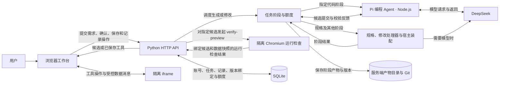

# ROOT 0.9 技术架构

本文对应公开仓库的 ROOT 0.9 源码与生产模式构建 `v4-ecf34a605b87`。

浏览器工作台负责需求输入、候选预览和工具操作。Python 服务管理账号、任务、额度、候选校验和保存。生产 Agent 模式下，Pi Agent Core 通过服务端 Node.js 子进程接入 DeepSeek，承担新建的代码实现，以及程序、网站和代码型台账的修改规划与实现。规格和其他阶段仍由对应处理器执行，Python 服务负责阶段校验和装配。

| 层 | 职责与实现 |
| --- | --- |
| 产品入口 | 官网提供游客试玩和工作台入口，工作台负责用户会话中的生成、修改及操作。见 [public_site.py](../public_site.py) 和 [workbench/](../workbench/)。 |
| HTTP 与任务 | 校验会话、工具归属和请求来源。任务状态和请求标识用于并发防重及断线后核对。见 [workbench.py](../workbench.py)、[staged_jobs.py](../staged_jobs.py) 和 [OpenAPI](../api/openapi.json)。 |
| 编程 Agent | Python 宿主管理 Node.js 子进程和模型调用预算。Pi 根据需求操作当前候选的允许文件，并接收校验诊断。修改以当前已保存的工具为起点。见 [coding_agent.py](../coding_agent.py) 和 [coding-agent.mjs](../coding-agent.mjs)。 |
| 校验与预览 | 服务端检查候选源码，再用隔离 Chromium 验证运行行为，例如页面样式是否实际生效、表单能否录入。用户侧预览使用 iframe、CSP 和出站限制，工具通过工作台宿主读写自己的记录。见 [runtime_verify.py](../runtime_verify.py) 和 [runtime-verify.mjs](../runtime-verify.mjs)。 |
| 持久化 | SQLite 记录账号、工具归属、数据修订和用量。服务端保存工具产物，用 Git 保存候选及源码版本。见 [accounts.py](../accounts.py)、[staged_jobs.py](../staged_jobs.py) 和 [trial_budget.py](../trial_budget.py)。 |

新建时，用户提交需求，服务记录任务并调度 Agent。候选装配后，工作台请求服务端执行运行检查。保存接口核对该检查结果与候选、数据快照的绑定，随后保存并展示可操作预览。修改时，用户先看候选及改动。受支持的代码型台账回填和字段类型转换由服务端计算数据影响，并把当前数据修订绑定到这次确认。确认过期、候选检查失败或用户取消时，原工具及记录保持可用。

模型派发次数与用户成功次数分别计量。生产示例配置为单任务最多 100 次模型派发、每账号 1,000 次生成成功、共享 10,000 次模型派发。有效值由部署环境配置。见 [配置示例](../deploy/whole/whole.env.example)。

[账号与工具设计](账号与工具设计.md)记录信任边界，[Agent 接入规格](../specs/coding-agent-trial/spec.md)记录重构的验收要求，[公开验收摘要](公开验收摘要.md)给出复跑命令和案例。[开发与验收流程](开发与验收流程.md)记录研发协作中的 Agent 分工。
