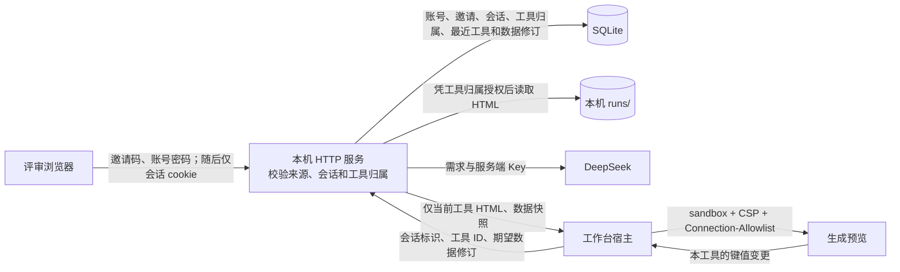

# 账号、工具与操作数据

## 架构与信任边界

- **AC-004 / TEST-004 / TASK-004** 邀请由本机 CLI 创建，随机生成、数据库只保存摘要。本地默认 24 小时、单次使用，期限和次数可配置。注册、扣减邀请码同一写事务。账号用 3–32 位 ASCII 用户名，大小写不敏感，密码 12–128 字符、独立随机盐与 PBKDF2-HMAC-SHA256（600,000 次，兼容系统 Python）。服务端存会话摘要和过期时间，浏览器使用 HttpOnly、SameSite=Strict 的 host-only Cookie。退出撤销会话。变更接口统一检查 Origin 与 JSON，受保护请求还须携带与 Cookie 会话一致的页面标识，避免旧页面在同浏览器换号后继续操作。回环 HTTP 为本地边界，部署须配置 HTTPS 和 Secure Cookie。 [OWASP 密码存储](https://cheatsheetseries.owasp.org/cheatsheets/Password_Storage_Cheat_Sheet.html) · [OWASP 会话管理](https://cheatsheetseries.owasp.org/cheatsheets/Session_Management_Cheat_Sheet.html)
- **AC-005 / TEST-005 / TASK-005** 工具归属从已认证账号取得，列表、详情、打开、提交候选与数据写入均按账号过滤。越权 ID 与不存在 ID 同样返回 404。工具元数据和数据存 SQLite，已生成 HTML 存现有本地运行目录，服务鉴权后才返回。数据以整份键值快照保存，最多 256 KiB。写入比较期望修订号，冲突提示重新打开，避免两个浏览器静默覆盖。账号级最近工具指针支持跨浏览器恢复。旧匿名产物无可信账号归属，保留在原位置供历史验证。 [SQLite 事务隔离](https://www.sqlite.org/isolation.html)
- **AC-006 / TEST-006 / TASK-006** 生成成功先产生仅服务端可见的草稿。候选初始化成功后原子发布并更新最近工具，界面才切换。候选失败、写入失败、重试过程中保持旧工具可操作；草稿不进入列表。历史切换读取服务端最新快照。开发验证双工具独立存储、重新登录与失败后继续保存。
- **AC-007 / TEST-007 / TASK-007** 工具 ID 和列表标题沿用首次生成结果。修改请求向模型提供用户指令、当前 HTML 和存储键名，SQLite 里的用户记录不拼入请求。新版仍在隔离预览启动。宿主确认候选读过已有键，SQLite 写事务确认所有旧键值原样保留，并同时比较 HTML 版本与数据修订。只有发布成功才替换预览。准备新版期间，旧工具仍可编辑。发布前短暂暂停当前预览的写入并等待已排队保存。遇到另一浏览器的新写入，取最新快照重建一次候选，再比较修订。仍冲突或不兼容时恢复旧预览的交互并显示原因。
- **ROOT-S3-IA-02** 发布确认丢失时先重放一次。同样拿不到确认时，服务端用与发布相同的 SQLite 写锁确认候选是否生效，并撤销尚未发布的同一候选。若迟到的发布请求之后到达，该候选已不可发布。浏览器以回读的当前版本和快照恢复预览；回读不可用时暂停编辑、隐藏版本标记，并提供「同步工具」。同一浏览器标签页刷新时仍会恢复待同步状态。发布直接返回明确的未写入错误时，旧工具恢复可编辑。
- **AC-004 / AC-016 注册直达** 注册在同一写事务内消费邀请码、创建账号并签发会话。成功响应带会话 Cookie 与页面标识，当前页面直接进入工作台并显示引导。普通登录和页面刷新从会话恢复入口进入工作台，因此不会重新触发自动引导。
- **AC-008 / TEST-008 / TASK-008** 每次发布在同一事务中写入工具版本、生效时间和说明。历史接口只返回已发布版本，工具归属和会话校验沿用已有入口。阶段 2 工具沿用其 HTML 和记录作为 v1，历史将其时间标为文件时间。
- **AC-009 / TEST-009 / TASK-009** `/updates` 是独立入口，与工作台使用同一响应安全策略。版本号对应本地候选发布记录，当前构建标识由实际运行源码计算。工作台内导航保留原预览文档和需求输入。直接访问更新页也可返回工作台。

## 验收用例

| 追踪 | 自动化验证 |
| --- | --- |
| AC-004 / TEST-004 / TASK-004 | 缺失、错误、耗尽和到期邀请不可注册；凭有效邀请注册；错误密码被拒；登录、退出后用旧 Cookie 重放失败。 |
| AC-005 / TEST-005 / TASK-005 | 两个独立浏览器上下文登录 A，互相保存并重新打开验证。原浏览器换 B 后列表隔离，直接访问 A 的工具 ID 读写均失败，旧会话页面不能以 B 的新会话操作。 |
| AC-006 / TEST-006 / TASK-006 | A 新建两个不同工具，各写记录；重新登录、逐个找回；新建失败后列表保持两项，旧工具继续编辑并持久化。 |
| AC-007 / TEST-007 / TASK-007 | 浏览器操作新版筛选，回读原记录及第二浏览器在准备期间写入的记录。接口验证拒绝丢数据、过期数据修订和竞争版本。 |
| ROOT-S3-IA-02 | `node tests/verify-workbench.mjs --main --publish-recovery` 注入明确拒绝、请求未到达、单次和双次确认丢失、回读持续失败及页面刷新，验证预览、历史和保存一致。HTTP 用例验证同步撤销待发布候选、拒绝迟到发布及查询权限。 |
| AC-008 / TEST-008 / TASK-008 | 账号隔离，v1 和 v2 均可查，失败候选不进历史。重开与重新登录后当前版和数据一致，阶段 2 已有工具可升级。 |
| AC-009 / TEST-009 / TASK-009 | 打开独立入口，核对当前构建与旧版说明。返回保持原预览文档及需求草稿。 |
| AC-001 / TEST-001 / TASK-001、AC-002 / TEST-002 / TASK-002 | 已有浏览器替身、UDP 正反对照、真实模型生成及整页恢复复测。 |

线上邀请发放对象、有效期、使用次数、个人与全局模型额度、限流和 HTTPS 为部署前决策。本地使用受控邀请和回环服务。

## 本地边界

账号和工具数据保存在一个本机 SQLite 文件，工具 HTML 及运行证据保存在同一运行目录。备份与迁移需同时保留二者。工具数据按修订检测冲突；用户重新打开工具后可加载最新已保存数据。同一浏览器多个标签页换号后，旧页面的请求会因会话标识不匹配而被拒，回到该标签页会重新载入。历史匿名工具没有可验证归属，作为旧版记录独立保存。可运行范围已验证到回环地址和 Chrome 156，跨设备实际接入归部署后验证。

本地首次试跑发现系统 Python 缺少 scrypt，因此采用可用的 PBKDF2-HMAC-SHA256。另有一次窄屏回归发现历史项使列表宽度溢出，已修复并在 390 px 复验。嵌套 WebRTC 探针仍为零包，合成嵌套样例刷新时可能初始化超时，工具引用保留。
