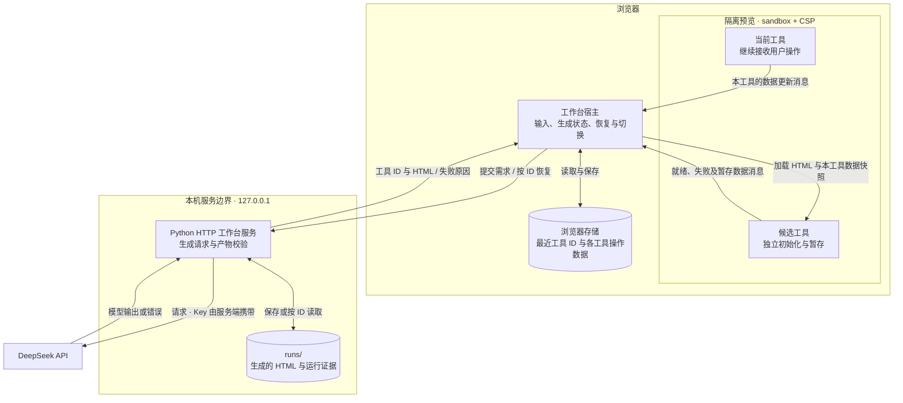

# ROOT Demo 质量门禁设计

2026-11-09，技术 Review 初审已记录，固定候选待验。本文由「ROOT 笔试 Demo 需求对齐」维护，开发方案与自测由「ROOT 笔试 Demo 首版工作台」提供。需求与验收编号沿用[实施计划](实施计划.md)，执行进度见[开发检查点](workbench-harness.yaml)。

> 用户补充的评审要求：「需求对齐了就开发了，不是应该还要有技术 Review 啊？就技术选型啊就架构层的东西」

## 交付前

| 门禁 | 触发时机 | 通过条件与证据 | 负责人 |
|---|---|---|---|
| G0 需求与设计评审 | 需求确认或变更时 | 首版范围、视觉基准及 AC 对齐。明确失败后仍可操作旧工具和刷新恢复的预期，执行证据归入 G2、G3。 | 需求定义，质量复核 |
| G1 技术评审 | 需求对齐后、受影响模块实施前。既已开工的部分在候选版本交接前补审。 | 确认模型调用、浏览器预览、存储和公开部署的边界。记录关键选型、取舍、风险、验证办法，以及影响哪些 AC。架构或部署边界变化时复审。 | 开发给出方案，质量审风险和可验证性 |
| G2 工程回归 | 改动后跑受影响测试，交接前跑完整本地回归 | Python 单测和替身浏览器回归通过。覆盖输入与输出校验、两类工具交互、刷新恢复、工具间数据隔离、失败保留旧工具及重试。安全负例须证明外部探针本身可达。 | 开发运行并提供证据 |
| G3 真模型与独立验收 | 固定本地候选后 | 开发先提交两类真实需求的请求、用量及操作证据。验收 Agent 再用同一候选，从正式工作台输入未用于开发调试的需求，亲自完成生成、操作和刷新恢复。两类证据均绑定构建标识和模型配置。 | 开发自测，独立验收出结论 |

### G1 技术评审要回答的问题

| 评审项 | 当前方案与评审结论待确认项 | 必需证据 |
|---|---|---|
| 工作台架构 | 本地版采用 Python 标准库 HTTP 和原生页面，进程绑定 `127.0.0.1`。部署前单独审查代理后的 Host、Origin、HTTPS 和服务边界。 | 请求链和信任边界图或简图，说明浏览器、工作台服务、DeepSeek、预览 iframe 各自能访问的数据 |
| 模型调用与资源 | 现有方案是服务端使用 DeepSeek，单次最长 120 秒，本地同一服务同一时刻只生成一次。审核异常映射、重复请求、限流、余额耗尽和配置切换。 | 受控超时、并发、无效输出等检查，真实请求及用量记录 |
| 不可信代码执行 | 审查 `sandbox`、`srcdoc`、CSP 和消息来源校验。覆盖父页读取、外部请求、iframe 自身导航以及废弃预览继续写入等边界。 | 在同样网络条件下用对照请求证明探针可达，再核验隔离预览未发出或未抵达；对导航单独验证 |
| 持久化与替换 | 本地服务保存生成 HTML，浏览器保存最近工具引用和各工具数据。确认候选何时可见、写入失败怎样保留旧状态。上线前审查跨访问者读取工具产物和服务重启后的恢复。 | 失败、重试、写入失败及刷新复测；上线前用两个独立浏览器会话验证隔离 |

技术评审记录可以写在本节，每项写明所选方案、为何选择、风险与验证方式、结论和责任人。本地验证与公开部署分别给结论。安全、数据和成本边界未确认时，阻断对应候选交接或开放。

### 本地技术 Review 记录

2026-11-09，核对开发中的构建 `v4-27e588e3f361`，供开发参考。**正式交接门禁在开发交出固定候选版本后执行。** 当前单进程架构适合首版单人验证。服务仅监听回环地址，模型 Key 留在服务端，模型产物在无同源权限的 iframe 运行。宿主将候选写入与当前工具分开，保存新工具引用后才替换旧预览。参见[服务端](workbench.py)和[预览与存储](workbench/workbench.js)。

- **开发中待复核，AC-001 / AC-002。** 单测通过。首次浏览器复跑验证了清单新增和整页恢复，但重试段等待超时，退出码为 1。加入阶段诊断后复跑，同一构建在「等待候选预览阶段」再次超时，页面读回却已显示新工具「已就绪」。这指向短暂阶段的观测时序，尚不足以判定业务行为失败。若最终候选仍能复现，可让替身按测试信号推进各阶段，在每个阶段先操作旧工具并确认持久化，再放行候选切换。两次运行均提前退出，末尾的 iframe 自身导航断言未执行。
- **对外开放待审，AC-003。** 本地服务按回环 Host 和 HTTP Origin 校验请求，生成产物按工具 ID 读取，当前入口适用于单人本机。对外开放前复审部署接入、访问者与生成产物的授权绑定、额度、原始需求的留存和回退。验收应包含两个独立访问者及一个原本可达的网络探针。

#### 本地首版技术架构图

宿主校验消息来源和预览实例标识。候选通过检查和初始化，且宿主保存数据与最近工具引用成功后，才替换当前工具。失败或重试期间，旧工具继续可操作。评审图按当前本地实现绘制，最终交付时按拟提交构建复核。访问控制、产物归属与额度纳入线上部署评审（G4 / AC-003）。

#### 本地选型与复测

单机首版沿用 Python 标准库和原生前端。一个本机进程足够承载当前生成与取回产物的流程，操作数据只需在同一浏览器按工具隔离，采用本地文件与浏览器存储。宿主通过窗口来源与当次预览标识校验消息。候选通过初始化并写入数据和最近工具引用后才切换，失败时由旧预览继续接收操作。这一选型以同一台机器、同一浏览器来源为边界。

2026-11-09 复测构建 `v4-27e588e3f361`，Chrome 156。Python 单测 1 项通过，`node tests/verify-workbench.mjs` 模型替身回归退出码 0。两类工具可操作，书单新增后整页刷新恢复，旧书单在失败后、等待模型和准备候选时均可新增。父页 DOM、外部请求和 iframe 自身导航负例执行完成，可达探针仅收到对照请求。上文首次回归超时为历史记录，当前替身复测已通过。正式工作台两次真实模型调用、固定版本独立验收和线上门禁待验证。

### 2026-11-09 技术 Review 初审

**本地架构可按当前计划继续开发。** 首版的目标是单人本机演示，Python 标准库 HTTP、原生页面、本地文件和浏览器存储足以支撑。以下为需求对齐任务对现有代码和证据的初审。已请开发在当前切片完成后补充选型理由、取舍和证据。正式验收从开发交出固定候选开始。

| 范围 | 现有方案与取舍 | 风险、验证与阻断条件 |
| --- | --- | --- |
| 生成代码隔离 · G1/G2 · AC-002 | 生成 HTML 在无同源权限的 sandbox iframe 执行。宿主和预览 CSP 共同限制资源与导航，消息桥只接受登记的 iframe 窗口及当次标识，按工具限定数据。 | 固定候选用 Chrome 和可达探针复验父页读取、外部 fetch/图片、嵌套或自身导航、预览调用生成接口。补查伪造或废弃预览消息不能写入当前工具数据。任何越界读取、请求、写入或缺少核心隔离证据，阻断本地候选交接。 |
| 失败、重试与恢复 · G1–G3 · AC-001 / AC-002 | 当前工具继续运行，候选独立初始化并暂存数据。候选数据与最近工具引用保存成功后才替换。服务保存 HTML，浏览器按工具 ID 保存操作数据，整页刷新时按最近引用取回。 | 用替身控制模型等待、预览准备和保存失败。失败后及重试两个阶段都要向旧工具新增，并核对失败前后同一工具和既有记录。另在生成失败后、切换前刷新整页，核对仍恢复旧工具和已保存的记录。旧工具不可操作、记录丢失、错误切换或缺少复测证据，阻断本地候选交接。 |
| 开放访问与额度 · G4–G7 · AC-003 | 现有回环地址、Host/Origin 校验及单进程并发限制适用于本地。按工具 ID 取回的接口还需增加访问者归属校验。部署方案待评审。 | 在拟部署环境验证未授权访问、两个独立会话不能互读产物、访问者及全局限额、超额拒绝、暂停新生成时旧工具仍可操作。核对日志、产物留存和服务重启后的恢复。访问越权、额度无法强制、缺少回退或线上冒烟失败，阻断开放。 |

**开发中观察。** 构建 `v4-0dcfaae42ca6` 的替身浏览器报告覆盖失败、重试、刷新恢复、窄屏及隔离，结果为通过。真实模型自测前两次在鉴权阶段收到 HTTP 401。本机配置修正后，同一构建的两类工具生成、操作和首条刷新恢复均通过。固定候选的证据复核及独立验收另行记录。[替身报告](runs/workbench-v4-fixture/workbench-check.json) · [真实模型通过报告](runs/workbench-live-61tvqY/workbench-check.json)

**开发待补。** 提交固定构建标识、启动入口、单测与替身回归记录，以及两条真实需求的请求 ID、模型、耗时、用量和实际操作。真实自测应包含整页刷新恢复。需求对齐任务复核 G1–G3 的开发证据后交独立验收，独立验收结果用于正式交付判断。

**用户待决定。** 本地继续开发已有授权。进入 AC-003 前，由用户确认开放对象和试用时间、每人及总调用预算，以及试用结束后生成产物与日志的留存期限。这些决定在部署评审时落为具体配置和测试预期。

## 线上

部署以可独立演示的版本为单位。首版先将 REQ-001 的生成和 REQ-002 的预览及恢复合入同一个本地候选，完成本地独立验收后，再按部署授权选择拟发布版本。部署后从该版本的线上入口执行 AC-003。

| 门禁或护栏 | 触发时机 | 判定与处置 |
|---|---|---|
| G4 发布准备 | 拟部署或开放评审访问前 | 在候选环境核对访问控制、每人及全局额度、日志脱敏、产物归属、持久化、降级开关和回退方式。准备可复验入口，对应 AC-003。开发说明配置，质量核验，用户决定开放。 |
| G5 上线冒烟 | 每次部署或改变模型、提示词、存储、隔离配置后 | 使用新浏览器会话打开部署入口，按 AC-003 真实生成、操作、刷新恢复，记录版本和请求证据。冒烟失败先停止开放评审访问，按问题修复、切回上一可用版本或暂停新生成。 |
| G6 运行保护 | 每次生成请求及预览替换时 | 服务端执行额度、并发、超时和输出校验。候选检查、预览初始化和保存都成功后才切换。安全异常、数据串读或预算耗尽时暂停新生成，保留旧工具的可用性。 |
| G7 监控与反馈 | 评审试用期间以及发现异常时 | 分开记录请求量、任务完成数、失败阶段、延迟和 token 用量。区分供应商调用成功、产物通过检查、预览就绪和用户实际完成。质量负责人据此归因，补替身回归或真实题集，再用新版本复验。 |

线上记录优先使用版本、请求标识、失败阶段、耗时和用量。预算及持续失败告警阈值随部署环境与试用额度评审确定。样本少时报告通过数和总数，保留失败实例。

## 11 月 9 日交付计划

首版共 3 项需求。REQ-001、REQ-002 已通过开发自测，合成一个本地候选。REQ-003 是同一产品版本的线上交付与复验。当前正式验收为 0/3，尚余本地独立验收的 2 项和线上验收的 1 项。

**阶段提测与整版交付。** 阶段提测以本地 Git 提交固定源码。开发从该提交启动工作台，确认构建标识与入口可用，给验收方提交号、入口、涉及的 AC 和已有自测证据即可。已有冻结包作为历史证据保留。等首版约定范围收齐并通过相应门禁，再按整版整理演示、架构、运行及验收材料。

| 工作 | 责任与启动条件 | 完成证据 |
| --- | --- | --- |
| 固定本地提测版本 | 现有运行源码与 `v4-0dcfaae42ca6` 冻结版一致，当前待首次 Git 提交并核验该提交启动的入口。 | Git 提交号、对应构建标识和本地入口。已有证据可按同构建复用。[候选补验](runs/candidate-v4-0dcfaae42ca6/runs/g2-fixture/workbench-check.json) · [候选真模型证据](runs/candidate-v4-0dcfaae42ca6/runs/workbench-live-61tvqY/workbench-check.json) |
| 独立验收 AC-001、AC-002 | 本地提测版本与入口就绪后开始。预留 30–45 分钟，发现问题时补修复和受影响复测时间。 | 从正式工作台实测新需求、交互和整页恢复，核对同构建的失败、重试和隔离证据，给出两项结论。 |
| 整版材料与部署准备 | 架构图和证据索引可随开发维护。部署平台、访问对象、有效期及额度可并行确认。首版范围收齐后汇总整版材料。 | 本地材料可供复核。线上参数形成可评审方案，拟部署环境有明确的 G4 验证办法。 |
| 线上交付 AC-003 | 本地独立验收通过、G4 条件齐备并获得部署授权后，按一个版本部署。线上环境引入变更时复验受影响路径。 | 新会话从线上入口完成真实生成与操作，核对访问边界、额度及回退，保存 G5 记录。 |

今天优先完成固定本地版本和独立验收。线上准备并行推进，具备部署条件后接着跑 AC-003。出现阻断时，记录剩余项和责任任务，已通过的本地结论单独保留。

## 证据与放行

- 每次交接保存门禁编号、关联 AC、版本或构建标识、环境、模式、结论、证据位置和负责人。真实模型结果同时记录模型及配置版本。一次修复后的复测对应新的执行记录。
- 使用通过、失败、阻塞、未执行四类结论。核心链路、隔离、数据完整性和额度保护缺少通过证据时，阻断相应交接或开放。体验类余项由用户确认是否接受，并记录影响范围。
- 先复用 `python3 -m unittest discover -s tests -p 'test_*.py'` 和 `node tests/verify-workbench.mjs`。第一个用于快速检查，第二个默认走模型替身。真实模型与独立验收另记，统一绑定同一候选版本。
- 优先核对最新候选的证据，早期样例和开发中报告用于定位与对照。真实模型候选验收、独立业务验收与线上门禁分别记录结论。
